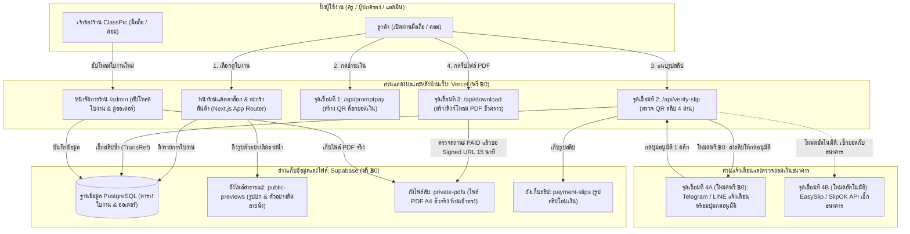

# พิมพ์เขียวระบบเว็บไซต์ขายใบงานดิจิทัล: ClassPic Store (BLUEPRINT)

> เอกสารฉบับนี้เป็นพิมพ์เขียวหลักของโปรเจกต์ **ClassPic — Learning & Creative Studio** (*Bright Outside — Clear Inside*) สำหรับใช้อ้างอิงโครงสร้าง จุดเชื่อมต่อ ชื่อตัวแปร และฐานข้อมูลทั้งหมด

---

## 1. มาตรฐานแบรนด์และรหัสสี (Brand Tokens)

โลโก้ต้นฉบับอยู่ที่ไฟล์ `assets/classpic-brand-sheet.jpg`

| ชื่อตัวแปรในโค้ด | รหัสสี (Hex) | บทบาทการใช้งานในหน้าเว็บ |
| :--- | :---: | :--- |
| `--cp-navy` | `#082340` | สีหลัก: แถบเมนูบน (Navbar), หัวข้อใหญ่, พื้นหลังส่วนท้ายเว็บ (Footer) |
| `--cp-blue` | `#1C64B8` | สีรอง: ป้ายหมวดหมู่วิชา, ลิงก์, กรอบเน้นข้อมูลสำคัญ |
| `--cp-sky` | `#B5D5F2` | สีพื้นหลังอ่อน: พื้นหลังการ์ดตัวอย่างใบงาน, ป้ายระดับชั้น |
| `--cp-orange` | `#F5760A` | สีจุดเด่น (CTA): ปุ่ม **"หยิบใส่ตะกร้า"**, ปุ่ม **"ชำระเงิน"**, ป้ายราคาโปรโมชัน |
| `--cp-bg` | `#F8FAFC` | สีพื้นหลังหน้ากระดาษเว็บ สบายตา ขับให้ภาพตัวอย่างใบงาน A4 ดูโดดเด่น |

---

## 2. แผนผังโครงสร้างและจุดเชื่อมต่อทั้งระบบ (System Architecture)



---

## 3. ภาพร่างหน้าจอทั้ง 5 หน้าหลัก (Visual Wireframes)

### 3.1 หน้าแรกและแคตตาล็อกใบงาน (`/`)
```text
+-----------------------------------------------------------------------+
| [C] ClassPic                       [ค้นหาใบงาน...]   [โหลดไฟล์เดิม] [🛒 2] |
|     LEARNING & CREATIVE STUDIO                                        |
+-----------------------------------------------------------------------+
|  🌟 HERO BANNER (พื้นหลังสีกรมท่า #082340 + ตัวอักษรสีขาว/ส้ม)           |
|  "ใบงานสร้างสรรค์ ขนาด A4 มาตรฐานไทย ปริ้นท์คมชัด พร้อมใช้สอนทันที"       |
|  [🎁 ดาวน์โหลดใบงานตัวอย่างฟรี 2 แผ่น]                                   |
+-----------------------------------------------------------------------+
|  ตัวกรอง: [ทั้งหมด] [อนุบาล] [ป.1-ป.3] [ป.4-ป.6] [การศึกษาพิเศษ] [2 ภาษา] |
+-----------------------------------------------------------------------+
|  +--------------------+  +--------------------+  +--------------------+
|  | [รูปตัวอย่าง A4]    |  | [รูปตัวอย่าง A4]    |  | [รูปตัวอย่าง A4]    |
|  |  คาดลายน้ำ ClassPic |  |  คาดลายน้ำ ClassPic |  |  (Coming Soon)     |
|  +--------------------+  +--------------------+  +--------------------+
|  | ใบงานภาษาอังกฤษ ป.1 |  | ชุดฝึกเชาวน์ปัญญา    |  | ชุดคณิตคิดเร็ว ป.2   |
|  | 📄 25 หน้า A4 + เฉลย|  | 📄 30 หน้า A4      |  | ⏳ เร็วๆ นี้         |
|  | ฿59  (ปกติ ฿99)    |  | ฿79                |  |                    |
|  | [🔍 ดูตัวอย่าง] [🟠ซื้อ]|  | [🔍 ดูตัวอย่าง] [🟠ซื้อ]|  | [🔔 แจ้งเตือนเมื่อมา] |
|  +--------------------+  +--------------------+  +--------------------+
+-----------------------------------------------------------------------+
```

### 3.2 หน้าดูตัวอย่างใบงานติดลายน้ำ (`/products/[slug]`)
```text
+-----------------------------------------------------------------------+
| [< กลับหน้าแคตตาล็อก]                                          [🛒 ตะกร้า] |
+-----------------------------------------------------------------------+
|  +------------------------------+   ชื่อชุด: ใบงานคำศัพท์ 2 ภาษา ป.1     |
|  |                              |   หมวดหมู่: [ป.1] [ภาษาอังกฤษ 2 ภาษา] |
|  |      [ภาพตัวอย่างหน้า 1/3]     |   --------------------------------- |
|  |                              |   ราคา: ฿59.00                      |
|  |     (คาดลายน้ำโปร่งแสง        |   --------------------------------- |
|  |      ClassPic Studio         |   ✅ ขนาดกระดาษ: A4 มาตรฐานไทย      |
|  |      ห้ามนำรูปไปพิมพ์ซ้ำ)       |   ✅ จำนวน: 25 หน้า + เฉลยท้ายเล่ม   |
|  |                              |   ✅ ความละเอียด: PDF คมชัดสูง 300 DPI|
|  +------------------------------+                                     |
|   [หน้า 1]  [หน้า 2]  [หน้า 3]       [🟠 หยิบใส่ตะกร้า / ซื้อทันที (฿59)]   |
|                                     [📄 โหลดหน้าทดลองปริ้นท์ฟรี (1 หน้า)]|
+-----------------------------------------------------------------------+
```

### 3.3 หน้าชำระเงิน QR PromptPay & แนบสลิป (`/checkout`)
```text
+-----------------------------------------------------------------------+
|                        ชำระเงินและรับไฟล์ใบงานทันที                       |
+-----------------------------------------------------------------------+
|  ขั้นตอนที่ 1: ข้อมูลสำหรับรับลิงก์ดาวน์โหลด (ใช้ค้นหาไฟล์ย้อนหลังได้)        |
|  เบอร์โทรศัพท์ หรือ อีเมลของคุณครู: [ 081-234-5678                  ]     |
+-----------------------------------------------------------------------+
|  ขั้นตอนที่ 2: สแกนจ่ายด้วยแอปธนาคารใดก็ได้                                |
|  +----------------------------+   รายการที่สั่งซื้อ:                      |
|  |      [ THAI QR PAYMENT ]   |   1. ใบงานคำศัพท์ 2 ภาษา ป.1    ฿59.00 |
|  |      +----------------+    |   ----------------------------------- |
|  |      |   [QR CODE]    |    |   ยอดโอนสุทธิ:                  ฿59.00 |
|  |      |  ล็อกยอด ฿59.00 |    |   ชื่อบัญชี: ... (ClassPic Studio)     |
|  |      +----------------+    |   [💾 บันทึกรูป QR ลงมือถือ]              |
|  +----------------------------+                                       |
+-----------------------------------------------------------------------+
|  ขั้นตอนที่ 3: แนบรูปสลิปโอนเงิน                                         |
|  [ 📤 กดเลือกรูปสลิปจากอัลบั้มรูป ]                                       |
|  [🟠 ยืนยันการโอนเงินและรับไฟล์ PDF]                                     |
+-----------------------------------------------------------------------+
```

### 3.4 หน้ารับไฟล์ PDF & ค้นหาประวัติสั่งซื้อ (`/downloads`)
```text
+-----------------------------------------------------------------------+
|  ✅ ชำระเงินสำเร็จ! (รหัสคำสั่งซื้อ #CP-20261105-001)                     |
+-----------------------------------------------------------------------+
|  รายการใบงานของคุณ (ลิงก์ปลอดภัยเฉพาะคุณ):                               |
|  +-----------------------------------------------------------------+  |
|  | 📘 ใบงานคำศัพท์ 2 ภาษา ป.1 (A4 - 25 หน้า + เฉลย.pdf)              |  |
|  |    [📥 กดดาวน์โหลดไฟล์ PDF ตัวเต็ม] (ลิงก์มีอายุ 15 นาที กดขอใหม่ได้) |  |
|  +-----------------------------------------------------------------+  |
+-----------------------------------------------------------------------+
|  🔍 ค้นหาใบงานที่เคยซื้อไว้แล้ว (กรณีเปลี่ยนเครื่องหรือไฟล์หาย)               |
|  กรอกเบอร์โทร / อีเมลที่ใช้ซื้อ: [ 081-234-5678 ] [ค้นหาประวัติ]            |
+-----------------------------------------------------------------------+
```

### 3.5 หน้าหลังบ้าน Admin สำหรับคุณ (`/admin`)
```text
+-----------------------------------------------------------------------+
| 🔒 ClassPic Admin Panel          [แท็บ: จัดการใบงาน] [แท็บ: ออเดอร์ (1)] |
+-----------------------------------------------------------------------+
| ➕ เพิ่มใบงานใหม่ขึ้นหน้าร้าน (ทยอยลงทีละชุดได้ตลอดเวลา)                   |
| - ชื่อใบงาน:      [ ใบงานคณิตศาสตร์ ป.2 ชุดการคูณ              ]        |
| - ระดับชั้น/วิชา:  [ ป.2 ▼ ]  [ คณิตศาสตร์ ▼ ]   ราคา (บาท): [ 69 ]     |
| - จำนวนหน้า:     [ 20 หน้า A4 + เฉลย ]   สถานะ: [🟢 เปิดขายจริง ▼]      |
| - รูปตัวอย่าง (1-3 รูป): [ เลือกไฟล์รูป... ] (ระบบใส่ลายน้ำ ClassPic ให้อัตโนมัติ)|
| - ไฟล์ PDF ตัวจริง:      [ เลือกไฟล์ PDF... ] (เก็บเข้าถังลับ private-pdfs) |
| [🟠 บันทึกและนำขึ้นหน้าร้านทันที]                                          |
+-----------------------------------------------------------------------+
| 📋 รายการออเดอร์ล่าสุด                                                 |
| #CP-001 | 081-234-xxxx | ฿59.00 | [ดูรูปสลิป] | สถานะ: [✅ อนุมัติแล้ว]   |
+-----------------------------------------------------------------------+
```

---

## 4. สคริปต์ SQL สำหรับสร้างตารางใน Supabase (คัดลอกไปรันได้ทันที)

```sql
-- 1. ตารางเก็บรายการใบงาน (products)
create table if not exists public.products (
  id uuid primary key default gen_random_uuid(),
  slug text unique not null,
  title text not null,
  description text default '',
  grade_level text not null,
  subject text not null,
  price_thb integer not null default 0,
  original_price_thb integer,
  page_count integer not null default 1,
  has_answer_key boolean default true,
  status text not null default 'ACTIVE', -- ACTIVE, COMING_SOON, DRAFT
  preview_urls jsonb default '[]'::jsonb,
  sample_pdf_url text,
  full_pdf_path text,
  created_at timestamptz default now()
);

-- 2. ตารางเก็บคำสั่งซื้อ (orders)
create table if not exists public.orders (
  id uuid primary key default gen_random_uuid(),
  order_code text unique not null,
  customer_contact text not null,
  total_amount_thb integer not null,
  status text not null default 'PENDING_VERIFY', -- PENDING_VERIFY, PAID, REJECTED
  created_at timestamptz default now()
);

-- 3. ตารางเก็บรายการสินค้าในแต่ละคำสั่งซื้อ (order_items)
create table if not exists public.order_items (
  id uuid primary key default gen_random_uuid(),
  order_id uuid references public.orders(id) on delete cascade,
  product_id uuid references public.products(id) on delete restrict,
  price_at_purchase integer not null
);

-- 4. ตารางเก็บรหัสอ้างอิงสลิปเพื่อกันสลิปซ้ำ 100% (verified_slips)
create table if not exists public.verified_slips (
  trans_ref text primary key,
  order_id uuid references public.orders(id) on delete cascade,
  slip_image_path text not null,
  verified_amount integer not null,
  verify_mode text not null default 'MANUAL_ADMIN', -- MANUAL_ADMIN, AUTO_API
  verified_at timestamptz default now()
);
```
